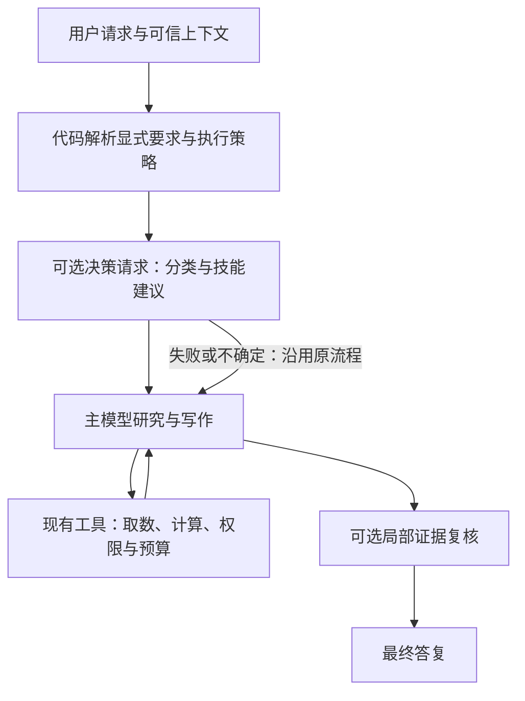

# Jev 类决策模型引入分析

- 日期：2026-10-23，Asia/Shanghai。
- 状态：分析与建议，尚未实施；不代表模型已经接入运行链路。
- 范围：Eugene Krab 当前工作区，包括尚未提交的评测与 A 股技能改动。
- 目标：判断哪些语义决策值得交给专用决策模型，明确收益来源、成本条件和验证顺序。

## 1. 建议

值得做一个范围有限的试验。优先顺序是：离线评测 → 请求与技能建议 → 有证据的报告复核 → 检索与监控优化。

主模型继续负责研究计划、工具参数、证据综合和报告写作；TypeScript 工具继续负责财务计算、技术指标、权限与执行预算。新增模型负责定义清楚、有固定答案空间的语义判断。

当前可以立即评估的是硅基流动的 `Kev-4B` 与 `SemIf`。官方 Jev 应作为独立候选，获得相应访问凭据后使用同一份数据比较。兼容同一种请求格式不能证明模型能力、概率校准或计费相同。

## 2. 已确认的事实及其限度

| 事项 | 当前证据 | 能得出的结论 |
| --- | --- | --- |
| 硅基流动访问 | 本会话使用项目的 `SILICONFLOW_API_KEY` 查询 `/v1/models`，HTTP 200，共 98 个模型 | 列表没有名称包含 Jev 或 TypeSafe 的条目；包含 `Kev-4B`、`SemIf` |
| 决策接口连通性 | 两个模型各完成一次中文技术分析请求分类，均 HTTP 200，选择 `technical_only` | 接口可调用；不构成中文能力、稳定性或准确率基准 |
| 单次耗时 | 上述两次客户端观测分别为 148ms、114ms | 仅为两个样本，包含网络与服务耗时；不能估算 p95 或全流程提速 |
| 官方 Jev | 本项目尚未验证 TypeSafe 账号访问 | 官方资料可以说明产品契约，不能代替本项目实测 |
| 本地评测基础 | 当前 A 股数据集为 6 个用例、30 条 rubric，6 个用例都有行为要求 | 可以作为种子集；不足以决定生产阈值 |

Jev 的核心输入是 `state` 与独立的 typed questions，输出包括 Choice、Score、Noul。Choice 是固定候选选择，Score 是有序等级评分，Noul 是是非命题的概率。生成自由文本的任务应继续由生成模型完成。[TypeSafe Introduction](https://docs.typesafe.ai/introduction)

硅基流动将 `/v1/systemone` 标为 Alpha，文档当前列出 `Kev-4b`、`SemIf`，说明目前免费，但可能调整或停止。实际请求应使用模型列表返回的大小写 `Kev-4B`，不要仅依据文档示例拼写。[SiliconFlow System One](https://docs.siliconflow.cn/docs/api/systemone-post)

这里有三个影响项目可行性的限制：

- 官方 Jev 以英语为主要训练语言；Kev 作者模型卡也写明 English，并把其他语言列在适用范围之外。该模型卡验证的上下文长度为 8,192 tokens，不能把能接收更长文本当作效果已验证。硅基没有在已查资料中说明其托管 checkpoint 与该模型卡的映射，因此这些是候选风险，不能直接代替对托管服务的测试。[TypeSafe Models](https://docs.typesafe.ai/models)、[Kev 作者模型卡](https://huggingface.co/jaredpalmer/kev-4b)
- SemIf 作者明确尚未建立适合生产阈值的校准概率，也报告过高分误判与选项顺序影响。兼容接口和提供校准工具，不代表硅基托管的概率已经通过本项目验证。[SemIf 作者实验结果](https://raw.githubusercontent.com/TheoLeeCJ/SemIf/master/docs/RESULTS.md)
- 官方 Jev 的 Choice/Score `confidence` 来自概率分布的统计量，不是独立的判断正确率；Noul 只有“是”的概率，没有独立 confidence。不能把 `confidence=0.95` 当作“本项目正确率 95%”，更不能跨模型复用一个阈值。[TypeSafe Confidence](https://docs.typesafe.ai/confidence)

官方模型文档目前列出 `jev-1.13.0`、`jev-1.14.0`，其中 `jev-latest` 仍映射 1.13.0，`jev-preview` 映射 1.14.0。若接官方服务，应固定经验证的版本；若托管服务无法固定版本，则保存返回的模型身份与模板版本，并在供应商变更或行为漂移时重评。[TypeSafe Models](https://docs.typesafe.ai/models)

## 3. 当前项目的适配点

以下收益是基于源码机制的推断，尚未经过对照实验。

| 场景 | 当前实现 | 建议交给决策模型的部分 | 主要收益 | 优先级 |
| --- | --- | --- | --- | --- |
| 自动评测 | [`createRubricEvaluator`](../../src/evals/evaluator.ts) 用聊天模型逐条判断并生成解释 | 单条语义标准是否满足、与参考事实是否矛盾 | 降低重复判分成本，便于批量回归 | P0 |
| 请求与技能建议 | [`Agent`](../../src/agent/agent.ts) 绑定工具后由主模型决定工具与技能 | 研究范围、候选技能、是否缺少必要上下文 | 减少跑错流程和无关工具调用 | P1 |
| 报告证据复核 | [`stock-analysis`](../../src/skills/stock-analysis/SKILL.md) 要求主模型发布前自行检查 | 给定原文是否支持某条结论、事实与观点是否混写 | 提高报告可核查性，减少语义失真 | P1 |
| 检索结果筛选 | [`hybridSearch`](../../src/memory/search.ts) 已有向量与关键词融合、时间衰减、MMR；[`web_search`](../../src/tools/search/web-search.ts) 聚合供应商结果 | 候选片段与问题的相关性、证据类型 | 减少无关上下文与无效页面处理 | P2 |
| 告警语义去重 | [`executeJob`](../../src/cron/executor.ts) 先完整研究，再按固定 token、英文短语和精确重复判断通知 | 新旧证据是否属于同一事件、是否有实质语义变化 | 减少重复通知 | P2 |
| 监控研究前筛选 | 当前尚无通用的新旧结构化证据快照筛选层 | 在新数据已获取后判断是否需要完整研究 | 有条件地减少完整 Agent 运行 | P2，依赖新增数据与状态机制 |
| 子代理与模型建议 | [`resolveSubagentModel`](../../src/tools/subagent/spawn-subagent.ts) 按类型及显式环境变量选模型 | 任务是否有可隔离研究分支、是否需要升级模型 | 减少不必要委派；后续可能优化模型成本 | P2/P3 |
| 长期记忆筛选 | [`runMemoryFlush`](../../src/memory/flush.ts) 在接近压缩阈值时调用生成模型提炼记忆 | 是否包含值得长期保留的新偏好或稳定事实 | 减少临时行情进入记忆，可能省掉空提炼调用 | P3 |

## 4. 优先场景的具体用法

### 4.1 离线评测：最适合先验证

现有评测器已经将标准拆成 `correctness` 与 `contradiction`，每条要求一个 `passed` 值。这与原子问题高度匹配。最终分数和“一旦核心矛盾则归零”的规则仍由现有代码计算。

适合的命题包括：答案是否明确承认来源不足；是否把券商预测表述为公司披露；是否包含给定的事实；是否将技术状态表达成未来价格必然变化。

财务金额、币种、报表期、归母净利润字段和百分比算术，应尽量先做确定性检查。决策模型只负责剩余的语义等价或表述关系，不能接管金额比较。

接入还需处理两个差异：

1. 当前输出包含自由文本 `rationale` 和 `comment`，决策模型不能直接补齐。可用模板说明判定结果，对有争议或需要解释的条目调用原判分模型或人工复核；不能把模板当成模型的推理依据。
2. 缺少答案、接口失败或概率不确定时，应标为待复核或回退，不能默认为通过。

[`evaluateBehavior`](../../src/evals/behavior.ts) 检查是否使用必需工具、是否超预算、是否出现禁用短语，已有确定性依据。它继续用代码执行，不增加模型调用。[现有评测测试](../../src/evals/evaluator.test.ts)、[行为检查测试](../../src/evals/behavior.test.ts)

收益主要发生在开发与评测阶段，不会自动缩短用户收到报告的时间。验证指标应是与人工标签的一致性、关键错误漏检率、复核比例、每千条标准的完整成本与耗时。

### 4.2 请求与技能建议：最有机会改善用户体验

例如将请求分为：仅技术、仅基本面、仅新闻、单公司综合、多公司比较、估值或备忘录、其他或不明确。分类同时需要少量可信会话上下文，否则“那和五粮液比呢”不能只看最后一句。

一次请求可询问研究范围、候选技能、是否缺少研究对象等独立问题，再由代码组合结果。第一阶段只向主模型提供建议，不据此移除正常工具。用户明确要求、已加载技能、渠道限制和原有来源策略继续生效。

项目特有的要求包括：

- 综合单只 A 股必须先加载 `stock-analysis`，再执行业务工具；分类建议不能省略这一步。
- 窄技术问题仍然直接使用技术工具；普通单公司综合研究仍由主模型完成最终综合。
- 低把握、超时、拒绝判断或多轮指代无法消解时，继续原来的主模型流程，不强制用户重新表述。
- 若未来按类别绑定更小工具集，需要重新验证所有有效研究路线；不能把软分类结果当作访问权限。

潜在收益是更少的错误技能、无关搜索、过度委派和重复研究。当前项目并没有一个可直接删除的独立“意图分类大模型调用”：主模型在同一轮同时选择工具并规划后续。因此只插入分类建议，会增加一次前置延迟；只有后续减少了错误执行、上下文或大模型轮次，才有净速度与成本收益。[TypeSafe Intent Routing](https://docs.typesafe.ai/patterns/intent-routing)

### 4.3 报告复核：用局部证据判断表述

给决策模型一条报告结论及其对应证据片段，询问：证据是否支持该表述、是否将第三方观点写成事实、是否把历史状态写成未来保证、是否遗漏了关键限定。

例如，“券商预计下一年利润增长”不能直接支持“公司已经披露利润增长”；“当前价格位于某均线上方”不能直接支持“近期发生向上突破”。这类检查需要原文语义，适合构造明确的判断问题。

URL 是否存在、数据日期是否匹配、单位与周期是否一致等仍优先用代码检查；来源类别中的“权威”也不能仅凭语气或域名推断。模型只能判断给定证据与结论的关系，无法证明未提供的来源真实可靠。

只对有明确证据引用的核心结论复核，避免把整份长报告和全部历史记录反复发送。证据不足时返回 `unsupported` 或 `insufficient`；发现问题后由主模型做一次有界修正并保留不确定性。

这通常是增加少量成本换报告质量。要衡量的是错误通过率、误报导致的无用改写、修正次数和发布延迟，不能宣称消除幻觉。

### 4.4 检索与重排：减少传给主模型的无关材料

在已有初步召回之后，对候选片段按“直接支持问题、补充背景、无关、证据不足”等等级评分，保留 URL、日期、来源类型及原片段。MMR 继续负责多样性，embedding 与关键词继续负责召回。

网页搜索目前只做供应商调用与故障切换，没有统一的语义重排层；不同供应商虽可能返回 JSON，仍需明确候选字段和来源保留契约。尤其 `web_fetch` 当前会用快速生成模型处理页面，若在处理之前筛掉无关页面，才可能省掉该次生成开销。[web_fetch 当前实现](../../src/tools/fetch/web-fetch.ts)

应和“不增加任何模型”及专用 reranker 比较。如果主要目标仅是相关性排序，专用 reranker 可能更合适；决策模型的额外价值在于同时判断证据类型与语义关系。重点测关键证据召回率，不能只看输入 token 减少。

## 5. 定时监控、委派与记忆的特殊条件

### 5.1 定时监控必须分成两个收益阶段

当前顺序是完整 Agent → `evaluateSuppression()` → 投递。此处增加语义去重，可识别不同措辞下的相同事件，减少通知打扰，但前面的研究费已经发生。

要节省研究费，需要先以确定性工具获取最新数据，持久保存上次已核实的证据快照，再做结构化差异和语义变化判断，只对有变化或不确定的任务启动完整研究。没有新数据就无法可靠判断“没有变化”。价格阈值、日期和数值变化由代码比较。

仅在 `on_actionable_result` 模式评估这种优化。`always` 是定时报告，成功运行后仍应报告；一次性任务的完成状态、错误告警和原有来源限制继续由原机制控制。模型出错或数据不全时，不默认静默。监控价值应分别衡量重复通知下降、重要事件漏报、研究运行次数与全链路成本。

### 5.2 委派与模型选择先提供建议

可以判断“是否存在一个与主任务独立、输入输出明确的研究分支”。只推荐已有合法的 `research`、`analysis`、`technical-analysis` 等类型，不把完整普通单公司研究外包，也不让模型扩大子代理的工具访问。

显式用户要求、`SUBAGENT_ANALYSIS_MODEL`、`SUBAGENT_MODEL` 等配置保持优先级。未来若做按难度选模型，需要按正确率与完整成本测量，而不是把低置信度直接等同于必须使用最贵模型。[当前模型选择代码](../../src/tools/subagent/spawn-subagent.ts)

### 5.3 记忆判断收益受调用频率限制

当前 flush 只在上下文达到阈值后触发；并非每条消息都在提炼长期记忆。只有“空提炼”足够多时，一个前置是否值得存储的判断才可能省钱。实际记忆文本与会话摘要仍需生成模型，压缩阈值继续用代码判断。

可以先检测新偏好、长期研究口径和稳定约束，过滤临时行情。涉及用户投资与个人信息时，新增供应商会扩大数据处理范围，应最小化发送内容，不能默认传送整个私人记忆库。

## 6. 不适合交给决策模型的职责

- 财务单位换算、同比环比、日期比较、技术指标与确定性阈值判断：保留 `financial_calculator` 和现有技术分析实现。
- 最终公司研究结论、报告与备忘录写作、会话摘要和压缩摘要：继续使用生成模型；仅对必要的局部判断辅助分类。
- 为未获取的行情、公告或财报补事实；预测股票涨跌或解释未来收益概率：本计划没有这样的数据或验证基础。
- 重建技术工具内部的研究事件、用模型结果改写公开中性技术契约：保留 [`toPublicTechnicalAnalysisResult`](../../src/tools/finance/technical-analysis/assessment.ts) 的职责。
- 文件写入批准、渠道归属、消息接收人、来源 allow-list、工具预算与并发限制：保留 [`AgentToolExecutor`](../../src/agent/tool-executor.ts) 等代码控制，概率输出不能授予权限。

## 7. 建议的最小接入结构

新增一个小的 `src/model/decision.ts` 模块处理 System One 请求、响应校验、超时、取消、模型身份和显式的不可用结果，先接硅基流动。只有真正接第二家服务时再抽取必要的供应商差异。

它不实现聊天接口，也不伪造 `AIMessage`。`src/model/llm.ts`、聊天模型菜单和主模型配置继续服务于生成任务。

业务侧分别拥有判断模板、有限候选集、版本和阈值。响应中的模型名、概率及原始 confidence 可以保留为评测元数据；外部响应缺字段或候选不合法时走不可用路径。首期只实现实际需要的 Choice 与 Noul，不必提前搭建任意模型工作流框架。

建议具备关闭、旁路观察、辅助建议三种模式。旁路观察是执行原流程同时记录候选决策，不改变结果；默认关闭。独立设置决策模型，不把当前主模型或所有子代理切换成决策模型。

接口应尊重上层 `AbortSignal` 和总执行期限；在线失败应快速回退，避免重试延长首字等待。缓存仅用于可安全复用的固定输入，键应包含模型、模板和策略版本。动态新闻或多轮语境不能仅按最后一句缓存。

## 8. 收益计算与成本约束

需要分别报告四类收益：

1. 质量：错误路由、证据失真、关键错误漏检是否下降。
2. 费用：主模型、子代理、决策、检索、重试及回退的总成本是否下降。
3. 延迟：首字等待和总耗时的 p50/p95 是否改善。
4. 运维与体验：评测周转、重复通知、人工复核量及新供应商故障是否可控。

对于一个可以完全独立替换的判分类步骤，设原步骤单次成本为 B、决策调用为 D、回退原步骤的比例为 f；替换后的预期成本约为 `D + f × B`。只有 `D < (1 − f) × B` 时该步骤才省钱。若存在共同保留的研究写作成本 S，全流程节省率为 `((1 − f) × B − D) / (S + B)`。

这个公式不能直接套到当前 Agent 的第一轮：该轮同时承担工具选择与研究规划，并不是一个可完整删除的分类调用。只增加建议时，应将新增调用视作开销，再观察是否减少后续无效执行。

同样，后置报告复核通常主要换取质量；通知后置筛选主要减少消息；只有前置筛掉完整研究、页面处理，或减少重复大模型执行时，才有相应费用节约。

官方 Jev 文档当前列出输入价格 $0.042/百万 token、输出免费。硅基 Alpha 免费是当前状态，长期测算应加入恢复收费的敏感性分析。不要将不同供应商的 tokenizer、usage 字段或免费阶段直接合并比较。[TypeSafe Models](https://docs.typesafe.ai/models)、[SiliconFlow System One](https://docs.siliconflow.cn/docs/api/systemone-post)

批量判断还有一个单独的优化机会：同一份答案的多条 rubric，或同一条请求的多个独立分类问题，可以共享 state 一次提交。TypeSafe 官方 cookbook 说明这样避免重复支付文档输入费用，问题定义本身仍计入输入；其中的倍数来自特定示例，不能照搬成本收益。硅基多问题的具体输入计量公式仍需用 usage 和收费说明核实，不能因格式兼容就假定规则一致。[TypeSafe Parallel Questions](https://docs.typesafe.ai/cookbooks/parallel_questions)

## 9. 验证与实施顺序

### 阶段 0：冻结样本，做离线对比

- 复用现有 A 股 6 例、30 条标准及人工复核机制，并补充自然语言变体、否定、多轮指代、无关信息与不确定样本。
- 初步可收集 100–200 个路由样本用于可行性筛选，按意图分层；训练式提示调优集与保留测试集按问题家族拆分，避免同模板泄漏。这个规模不能证明极低生产错误率。
- 评测判断需要正确答案和刻意构造的错误答案：金额单位错、周期错、归母字段错、把预测写成事实、无引用结论等。复杂数值题由代码核验后再评剩余语义。
- 人工标注是判分依据；现有 LLM judge 是对照，不是不可质疑的真值。候选模型不能自行裁定自己的错误。
- 对概率与拒绝判断同时评估：按任务报告误判与自动覆盖率、保留样本上的可靠性分布或 Brier score；检查标签顺序变化、否定表述和无关上下文是否改变结论。路由准确率与概率校准应分开衡量。
- 对比无新增模型、现有 LLM、Kev、SemIf；拿到官方 Jev 访问后再加入。固定数据快照，避免行情变动改变答案。
- 先使用合成或公开证据，不读取或上传私人聊天、持仓和记忆来凑评测集。

### 阶段 1：只替换评测中的适合部分

- 新增独立 decision client 和可选判分后端；语义解释按需回退。
- 保留人工评测模式和确定性行为检查，记录 uncertain/unavailable，避免失败伪装成高分。
- 按模型与任务分别验证阈值、错误分布、复核率和总成本。

### 阶段 2：路由旁路观察，再提供软建议

- 先观察候选路由与实际有效路线差异，不改工具权限、技能先后顺序和委派边界。
- 将误路由导致的错误与主模型不采纳建议区分统计；一个任务允许多条有效路线，不能只评价模型是否选中唯一字符串标签。
- 达到预先约定的测试要求后，只对高把握且可恢复的场景启用辅助建议；不确定时沿用原流程。

### 阶段 3：证据复核与检索

- 选择少量关键结论做一次有界复核，测试误报和增加的发布延迟。
- 对检索做独立对照，保留关键证据召回与来源归属；接口不可用时返回原检索结果。

### 阶段 4：监控与记忆

- 在新证据获取、快照保存和变更判断可审计后，再考虑减少告警型任务的完整研究运行。
- 证明重要事件不被静默、`always` 报告语义与错误通知不退化。
- 仅当记忆负样本占比与实际成本证明有价值时增加记忆前置判断。

### 每个阶段的停止条件

先约定容许的业务误判与成本、延迟上限；不要上线后才调整衡量方式。发现关键错误漏检、重要通知漏报、关键证据召回下降或持续增加全链路开销时，保持或恢复关闭模式。测试中的零错误是必要观察，不能视为未来零错误的保证。

## 10. 后续实现可能涉及的文件与检查

按阶段单独改动，不建议一次修改所有模块：

| 阶段 | 预计文件 |
| --- | --- |
| 最小客户端与离线评测 | `src/model/decision.ts`（拟新增）、相邻测试、`src/evals/evaluator.ts`、`src/evals/options.ts`、`src/evals/run.ts`、`env.example` |
| 请求与技能建议 | `src/agent/agent.ts`、`src/agent/prompts.ts` 及相关测试；必要时增加任务专属的决策模板模块 |
| 检索 | `src/memory/search.ts`、`src/tools/search/` 或 `src/tools/fetch/` 的候选适配处及对应测试 |
| 监控 | `src/cron/executor.ts`、快照持久化相关类型和测试、通知抑制模块 |
| 记忆 | `src/memory/flush.ts` 及相邻测试 |

所有这些都是后续建议，当前没有创建上述运行时模块或改变配置。实施时按仓库 checklist 运行相应 `bun test`、`bun run typecheck`、`git diff --check`，并更新最小范围的当前 harness context。

本次分析验证：已阅读相关源码与测试；用本地数据集解析器确认用例和标准数量；没有为本次分析发起新的付费模型评测。此前连通性测试与本次源码审查分开记录；未读取私人会话或记忆内容。文档变更按仓库要求检查格式和本地链接，不以此次文档审查声称运行时能力已经实现。

## 11. 尚待补齐的证据

- Kev、SemIf 在项目中文任务上的分层表现、概率质量与服务尾延迟。
- 实际运行频率、每条研究链路的模型与工具成本，以及误路由、重复通知的基线。
- 硅基托管模型的具体 checkpoint、最大上下文和供应商间 confidence 的可比性。
- 官方 Jev 账号访问及同数据集对照；没有访问时只能讨论该候选的文档能力。
- 供应商条款与数据处理是否适合将来可能涉及的个人金融信息；阶段 0 无需这些私人数据。

只有上述证据建立后，才应量化预期节省比例并决定扩大哪些场景。
